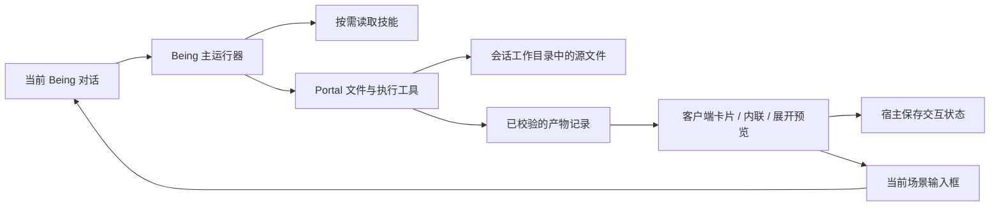

# Visualize 接入与 Portal harness 对标

2026-10-20。以下是基于当前源码、安装的 Visualize 1.0.50 技能与 Codex 官方资料形成的接入设计，尚未实现新的技能加载器、产物协议或 Codex 后端。

## 当前 review 结果

本轮检查本地未提交的客户端与 heart-portal 工具改动，修复：

- P2：预览组件用完整 scene JSON 作为 React key。新增的 portal_status 变化会导致卸载，关闭预览并丢失 HTML 页面中的交互状态。改为连接页面与 scene_id 决定生命周期；真正切换场景仍释放预览。
- P2：文件检查重试复用请求 ID，迟到的旧响应可能完成新请求；同批一个未知结果还会拖延已确认的文件。每次尝试使用独立 ID，立即完成已知结果，只重试未知路径。
- P2：用户点击后的文件检查尚未完成时，窗口焦点检查会使点击失效。明确点击优先于被动检查，补充实际 Electron 回归。
- P2：SVG 经图片分支直接返回全文，绕过 max_bytes、offset/limit 和 sha256。改为文本读取流程，补充预算与分段读取回归。
- 优化：本地文件检查复用路径解析时的 stat 结果，去掉一次重复文件系统调用。

本轮验证：TypeScript 类型检查、102 项相关客户端单元测试、95 项 Portal tools 测试。Electron 预览回归单独验证当前接口和旧 preload；系统文件管理器回调使用记录路径的替身，不代表 Finder/Windows Explorer 原生行为验收。当前成果为源码；未打包安装、重启用户客户端或发布。

## 为什么单独放入 SKILL.md 不够

安装的 Visualize 技能依赖以下宿主契约：

| 依赖 | 当前 Town-Client | 接入方式 |
| --- | --- | --- |
| 通过路径引用 HTML fragment，在对话内显示 | Markdown 本地文件卡片 → 侧栏预览 | 增加带稳定 ID 的会话产物引用；卡片、内联、展开使用同一产物 |
| CSS 变量、基础组件类、Lucide、部分 Tweak 能力 | 普通 HTML 只加载自身样式；智能 UI 是另一套组件协议 | 新建独立 fragment wrapper 和 Being 主题运行时；普通 HTML 原样预览 |
| widgetState / setWidgetState，modelContent 与 privateContent 分开 | 智能 UI 有 IndexedDB 存储，但只接受自己的状态类型 | 新增受大小限制的 JSON 状态存储与桥接，不直接把任意 JSON 塞入已有标量存储 |
| sendFollowUpMessage | 智能 UI 已能将继续操作放入当前输入框 | 复用同一场景输入框，宿主展示用户可审阅的追问，再走现有发送通道 |
| CDN 图表库、主题事件和自动高度 | 本地 HTML 禁止网络，无宿主状态桥 | 第一阶段固定本地依赖或原生 SVG；补充 ResizeObserver 高度与主题事件 |
| 按需读取技能及引用资源 | Portal 的 skills 配置目前用于 subagent；不等于 Being 主模型已有技能加载器 | 增加技能目录发现、读取协议，并让主运行器支持按需使用 |

不要让模型原样输出 OpenAI 的展示标记却期待现有 Markdown 自动识别。该标记是宿主协议的一部分。第一阶段采用 Being 自有、可版本化的产物协议；未来如需导入旧内容，可增加明确标识为兼容层的解析器。

现有 Intelligent UI 的 app 运行在 Worker，不能操作任意 HTML DOM。可复用它的会话归属、状态保存思路、继续对话与修复入口；不能直接拿 Worker 组件运行 Visualize HTML。

## 建议分工与数据流



全程保留原 scene_id，不为生成或预览自动创建新任务、subagent 或新对话。产物不是任务。工具的工作可以在当前轮内继续，预览状态也不随 Portal 重连而清空。

### 1. 技能按需加载

建议新增工具（名称和协议均为提案）：

- `portal_skills_list`：分页返回 id、name、description、version 和能力要求；不返回所有正文。
- `portal_skill_read`：按受信任包 ID、版本和包内资源路径读取有界文本；拒绝路径越界。
- 客户端提供导入本地技能目录、启用/停用、版本与运行时能力显示。先自编 Being 适配技能，再单独处理外部技能导入。

Being 主运行器仍需知道这些工具，并在适用任务里加载相应技能。初始上下文只放受预算约束的索引或发现工具；使用时读取正文及必需引用。用户不需要每次附加 HTML 说明，客户端也不往普通消息正文重复注入整套技能。

技能正文会在使用时进入模型上下文：这是模型执行技能所需的信息，与把固定说明追加到每条用户消息是两回事。前端加一个技能列表并不能自动改变远端模型行为。

### 2. 可持久化的会话产物

建议记录形状：

```json
{
  "schemaVersion": 1,
  "artifactId": "art_example",
  "sceneId": "desktop-example",
  "messageId": "message-example",
  "portalId": "registered-portal-instance",
  "kind": "html-fragment",
  "title": "交互示例",
  "revision": 1,
  "sha256": "content-digest",
  "entry": "artifacts/example.html",
  "runtimeVersion": "being-viz-v1"
}
```

归属字段由已验证的运行环境补齐，不能相信生成 HTML 自报的 scene/portal/message。客户端按 Being 连接、场景、产物 ID 存储状态；版本与摘要用于冲突检测和更新，不用内容变化直接清空所有兼容状态。源文件迁移和不兼容运行时升级需明确的状态迁移策略。

增加 `portal_artifact_register` 或文件工具的显式 artifact 参数：文件写入成功后检查入口、类型、大小和依赖，登记记录并返回结构化引用。工具事件到达客户端即可显示卡片，不依赖模型是否正确复制 Markdown；历史 Markdown 路径继续作为兼容入口。

当前 `beings://preview/<随机 ID>/...` 是短期访问能力，不是稳定产物 ID。重新打开或客户端重启时，按持久化记录重新验证文件并签发新能力。

本机文件只由本机 Portal 身份绑定。另一台机器上的相同绝对路径不能当作本机文件。远端产物需要显式受认证的文件传输并校验摘要，再作为本地副本预览。

### 3. fragment 运行时

独立实现小型 `being-viz-v1` 运行时，第一阶段包含主题、按钮/表单、SVG、自动高度和状态保存。普通完整 HTML 不注入此运行时，避免改变已有文件行为。

桥接建议使用 `window.being`，仅暴露 `getState`、`setState`、`requestFollowUp`、`reportSize` 等受控方法。HTML 没有 Electron IPC、任意文件读写或直接发送聊天的权限。宿主验证 source、会话能力与版本；限制消息字节数、频率和高度，iframe 保持无同源权限的沙箱。

按 Visualize 的设计分离 modelContent 和 privateContent，快照建议上限 16 KiB；状态更新只保存，不自动发起模型回合。默认不把 UI 私有状态附入普通消息；用户明确继续分析某个视图时，仅提交选中内容摘要。是否提供 `window.openai` 兼容别名应单独声明版本，不能声称完整支持其宿主 API。

原技能使用允许名单 CDN，当前客户端使用纯本地 CSP，两者不同。首版改写技能为本地依赖或 SVG；以后若开放 CDN，需按产物策略显式配置并测试，不能为了显示一张图整体放开网络。导出时生成独立 wrapper，用本地状态存储替代宿主方法。

### 4. 生成后的检查

增加有界的预览检查工具：在隔离运行时加载已登记产物，返回脚本异常、资源加载失败、横向溢出、主要控件测试结果和按需截图。截图只针对指定产物。错误可回到同一模型回合，修改同一个源文件并再次验证，成功后提升产物 revision。

以空格/中文路径、断网、深浅主题、窄屏、更新保留输入、重启恢复、场景切换、文件删除作为验收集合。外部 HTML 内容不拥有执行工具的权限。

## Portal 如何对标 Codex CLI

源码对照固定为此前已读取的 openai/codex commit `e18a20d6eb6f5ede32a69fb56e3fe276d5e9d914`，不是宣称逐项兼容最新版。

| 能力 | 当前基础 | 下一步及所属层 |
| --- | --- | --- |
| exec_command / write_stdin 会话 | 前台执行有输出预算、退出码、时长和取消清理；后台进程有 poll/write/kill | Portal：统一会话 ID、增量游标、yield、stdin/EOF、超时与回收，测试断连续读不重跑命令 |
| apply_patch / 文件编辑 | 单文件批量精确替换、原子保存、SHA-256 冲突检测 | Portal：评估兼容补丁格式、增加/删除/移动文件与可审阅 diff；当前不冒充多文件原子事务 |
| 技能发现与按需读取 | 工具说明；subagent 有 skills 配置 | Portal 提供资源，主运行器选择、加载并记录技能版本；客户端管理安装与显示 |
| 工具调度 | 连接并发上限、文件路径级修改锁 | 主运行器/调度层：工具只读/修改声明、依赖顺序、取消传播；不能对所有工具无条件并行 |
| 会话、重试、上下文压缩 | 客户端发送队列与流式展示 | Being 主运行器：预算、压缩、稳定 tool-call ID、恢复记录；写操作重试不能造成重复副作用 |
| 产物与反馈 | 本地文件预览与智能 UI | 客户端 + Portal：稳定 artifact ID、版本、状态、校验结果、同场景追问 |
| 工程度量 | 局部工具时长和输出大小 | 全链路：模型耗时、工具耗时、上下文字节、失败类别、取消延迟、生成到可预览耗时 |

先用固定任务集建立基线：创建 HTML、局部修改两次、读取大 SVG、搜索含依赖的仓库、取消长命令、恢复同一场景。比较首次成功率、模型往返次数、输入/输出 token、P50/P95 可预览耗时和重试次数。没有基准前不承诺效率提升百分比。

## 两条可选路线

1. **保留 Being 主运行器，逐项适配（当前建议）。** 先实现技能发现、产物登记和 fragment 运行时；Portal 逐步改善工具会话和反馈。与当前场景体系最贴合，但压缩、规划、恢复必须由主运行器配合。
2. **增加 Codex app-server 后端。** 客户端维护 Being 场景与后端 threadId 的稳定映射，同一场景使用 thread/resume 和 turn/start，接收 item/turn 事件，支持 steer、interrupt 和审批请求。它是后端执行引擎的接入，需要模型认证、工具暴露、历史和权限映射；不会自动带来 Visualize 桌面宿主。

不要每条消息执行一次新的 `codex exec` 来模拟长期聊天。无论选择哪个后端，产物都归属当前客户端场景。是否切换后端是独立产品决策，不随本次 review 自动替换现有 Being 服务。

建议交付顺序：①稳定当前预览；②技能发现与受控读取；③产物登记 + fragment 运行时 + 状态桥；④预览检查闭环；⑤按基准完善工具会话和主运行器，或接入 app-server。

## 依据

- 本机 Visualize：`/Users/d5/.codex/plugins/cache/openai-bundled/visualize/1.0.50/skills/visualize/SKILL.md`，包含 fragment、主题、状态、追问、CDN 和导出契约。该安装目录不能据此认定为公开 GitHub 包，也不能把 Codex 仓库许可推定为该插件的分发许可。
- [官方 Skills 说明](https://learn.chatgpt.com/docs/build-skills)：名称和描述先加载，使用时读取完整技能。
- [Codex App Server](https://learn.chatgpt.com/docs/app-server)：线程、回合、事件、继续输入和中断。
- [Codex tool scheduling 源码](https://github.com/openai/codex/blob/e18a20d6eb6f5ede32a69fb56e3fe276d5e9d914/codex-rs/core/src/tools/parallel.rs)。
- 当前实现范围和源码对照：[LOCAL-ARTIFACTS-AND-PORTAL-HARNESS.md](LOCAL-ARTIFACTS-AND-PORTAL-HARNESS.md)。
