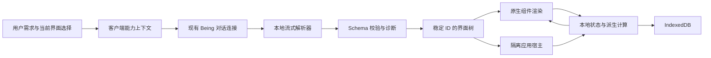

# Town Client 智能 UI 方案

> 设计与演进记录：已实现、待实现和历史方案按各节说明区分；当前使用与实现入口见[文档导航](../README.md)。文中代码路径与命令默认相对仓库根目录。

状态：最终实施方案（整合 OpenIntelligentUI 代码审阅）；现有 Beta 是验证原型，以下目标尚未实现或完成性能验证。

以第 10–13 节的最终决策为准；前文保留完整需求与设计依据。
日期：2026-10-12。

## 依据和结论

已阅读两篇文章的全部正文，包括 OpenUI 的方法、局限，以及官方页面展开的示例内容；本文未声称已逐个运行官方嵌入演示。

- [OpenAI 官方发布](https://openai.com/zh-Hans-CN/index/gpt-6-for-everyone/)明确强调按问题选择文字、视觉与交互，原生组件和编译器支持逐步呈现。自行车、餐饮计划、学习模拟、分账、储蓄和游戏展示了不同任务形态。
- [OpenUI 机制分析](https://www.openui.com/blog/how-chatgpt-intelligent-ui-works)是作者自己的逆向观察：描述语言、编译、隔离运行、组件渲染形成闭环；另有自定义应用通道。不能据此断言 ChatGPT 使用了 OpenUI 的开源实现，也不能把其观察视为官方协议。

以下均为 Town Client 的设计选择。目标是围绕用户任务生成可使用的界面。开启 Beta 后用户直接与 Being 对话；界面编译、渲染、计算和状态存储全部在本地。生成内容沿用当前模型连接，不新建 UI 服务。联网资料、地图瓦片和实时价格仍需要数据来源，不能宣称完全离线可得。

## 1. 任务到界面的决策

| 官方用例方向 | Town 的目标体验（设计建议） | 必需能力 |
| --- | --- | --- |
| 自行车结构 | 大幅结构图；点选部件高亮；旁边解释功能及关联 | 可缩放矢量场景、热点、选中态、说明联动 |
| 聚餐计划 | 人数调整后联动采购清单；时间线与任务勾选 | 步进器、派生列表、时间线、复制 |
| 衣橱搭配 | 图片卡片、色板、筛选、收藏组合 | 资源引用、网格、选择集合 |
| 自驾规划 | 路线与站点列表联动；逐站查看 | 地理数据绑定、地图适配器；离线可降级路线示意 |
| 概率与经济学习 | 调整参数，播放实验，解释当前结果 | 坐标图、采样、播放控制、公式、步骤 |
| 摄影学习 | 视觉示意与参数变化联动 | 图层、滑块、受控画布 |
| 分账与储蓄 | 可编辑记录、精确计算、结果曲线 | 数组状态、校验、财务计算函数、数据图表 |
| 小游戏 | 独立交互画布、键盘或触摸输入、重启 | 隔离小应用、受控计时、生命周期 |

模型先判断任务：解释结构、比较选项、制定计划、计算、探索模拟或自由创作。普通问答保持文字。交互必须改变有意义的结果，不能为了展示组件添加无关表单。

自行车首个验收样例：输入“帮我做一个自行车查看器”，默认获得可点选部件的自行车图。顶部为简短标题和部件筛选，主体是图，侧栏显示当前部件说明。窄屏将说明移到图下。预算、身高和选购比较只有在用户提出这些需求时才出现。

## 2. 两种渲染路径

### A. 原生组件路径：默认

模型描述任务结构、数据、状态、表达式、动作和布局意图。客户端校验后生成带稳定 ID 的中间树，由 React 渲染本机组件。模型不能指定任意 DOM、全局 CSS 或访问 Electron API。

现有 JSON v1 保持可读，作为兼容输入；新 v2 不继续扩展成一个无法维护的巨型 switch。

组件分层：

- 布局：Section、Stack、Grid、Split、Tabs、Disclosure、Divider。
- 信息：Text、Heading、Metric、Badge、List、Table、Timeline、Formula、Source。
- 输入：NumberInput、Slider、Stepper、Select、SegmentedControl、Checkbox、Toggle、EditableList。
- 视觉：Image、Gallery、Diagram、Hotspot、LineChart、BarChart、ScatterChart、Histogram。
- 动作：Button、ActionGroup、Copy、Reset、Export、ContinueConversation。

组件注册表同时定义 schema、默认值、主题 token、可访问性要求、状态类型和模型可读说明，避免提示词、校验器和渲染器各维护一套协议。复杂场景提供可组合范式，但不锁死内容或布局。

### B. 自定义可视化路径：有边界的扩展

当原生 Diagram/Chart 无法表达独特模拟、Canvas、声音或游戏时，提供本地 AppBlock。普通表格、表单仍走原生组件。

- 独立 iframe，sandbox 只启用所需脚本权限，禁用同源、导航、弹窗和直接网络；Electron 中没有 preload 或 Node 能力。
- CSP 默认拒绝资源，依赖随客户端打包，禁止远程 CDN 和任意模块加载。
- 对每个实例建立 MessageChannel；验证实例、协议版本、消息体、频率和大小。只有宿主白名单动作可以离开 iframe。
- 计算工作放进可终止 Worker；宿主监测心跳、限制运行时间，并提供停止/重启/静态回退。DOM 主线程死循环不能靠 Worker 超时保护，必须单独验证 Electron 进程隔离和可恢复性；未通过前保持 AppBlock 关闭。
- 注入一致的字体和主题变量；主题变化同步。ResizeObserver 回报内容尺寸，校验并限制高度。较大应用以摘要和“展开”进入独立面板，面板拥有自己的滚动区域。
- 表单与绘图状态通过受限桥接保存，不让应用直接读取宿主存储。

不复用未公开的 OpenAI DIL 运行时，不把网上抓取的执行器直接引入客户端。若未来评估开源运行时，另做许可证、打包大小、离线能力、协议稳定性和隔离评估，再决定复用范围。

## 3. 客户端架构与流式协议



“实时”分为三项：模型生成过程逐步显示；用户操作本地即时反馈；外部数据更新单独处理。第三项不能由前两项推导出来。

v2 建议使用代码围栏内的逐行 JSON 记录，通过现有文本 SSE 传输，不修改后端事件格式。记录类型：begin、state、data、node、text、commit。示意：

```json
{"op":"begin","version":2,"id":"bike-view","title":"自行车结构"}
{"op":"state","key":"selectedPart","initial":"all"}
{"op":"node","id":"layout","type":"Split","props":{"ratio":"visual"}}
{"op":"node","id":"parts","parent":"layout","type":"Diagram","props":{"dataRef":"bikeParts","selected":{"state":"selectedPart"}}}
{"op":"commit"}
```

这是拟议协议示意，当前 Beta 不支持这些记录。

解析器只处理新增字节；每条完整记录校验后进入暂存树，引用未齐的节点等待依赖。客户端按动画帧合并可发布的变化。根容器可先出现，子组件陆续补齐；不会等待整个 body 或整个嵌套容器完成。节点同 ID 更新属性，不重新挂载整个界面。纯文本增加、数据变更和结构变化分开处理。

错误组件局部降级，其他部分继续工作；保留最近有效版本；流结束时显示明确的未完成提示。用户可展开诊断，默认界面不暴露编译日志。不会自动反复请求模型修复。

## 4. 状态、表达式与继续对话

状态键使用 connection/being + sceneId + messageId + artifactId + schemaVersion，避免跨 Being 或场景污染。区分模型给的初始值、用户修改值、派生结果与临时视觉状态。

- 增量更新保留用户值；类型变化按迁移规则处理；不再存在的字段清理。
- IndexedDB 节流保存用户操作，重载和切换场景恢复。界面展开与收起使用同一状态实例。
- 计算图追踪依赖，仅重算受影响节点；检测循环依赖并提供错误值。
- 表达式支持受限集合操作、条件、格式化、数字和日期运算；限制集合长度、深度与总操作数。金额采用整数最小货币单位或明确精度方案。
- “按当前选择继续”显示将要发送的摘要，再走普通聊天发送入口。下一条普通用户消息可携带当前激活界面的精简状态快照，不发送全部 DOM 或所有历史界面状态。
- 本地操作不请求模型。模型只能在收到状态快照后知道用户的新选择，不能凭旧消息推测。
- 重置仅影响当前界面；清空会话一并清理关联状态。

动作明确分为本地计算、复制/导出、打开资源、继续对话。涉及发送、打开页面的动作由用户点击触发，绝不在模型渲染时执行。

## 5. 设计系统与聊天布局

用户看到的是“自行车结构”“聚餐计划”等任务标题。去掉显眼的 Intelligent UI 技术栏；只保留低调的交互状态和更多菜单。源码、协议、诊断移到菜单内。

- 智能界面作为独立消息块，与 Markdown 并列；不放进灰色聊天气泡，也不套多层同色容器。
- 样式集中在隔离命名空间；普通 Markdown 的 h3/p/table 规则不能影响组件。字号、间距、颜色由宿主统一提供。
- 桌面内容宽度建议 760–960px；图解优先分配主视觉区域，参数工具采用控制区+结果区。窄屏转单列。
- 采用 4/8px 间距尺度，区块 20–24px，字段 12–16px；标题 20–24px，正文 14–16px，辅助文字 12–13px。单位靠近数值，重要结果有层次但不全部放大。
- 使用浅色表面、清晰边界和少量强调色；深色主题单独验证。控件有焦点、悬停、禁用和错误状态，触屏操作目标至少 44px。
- 表格提供排序、筛选或分页，默认不展示无尽行；视觉解释优先使用图，而非将所有信息堆成表格。
- 动画只用于短暂提示更新，不把计算延迟伪装成动画；尊重减少动效设置。

## 6. 滚动是产品契约

用户反馈的“滚不到底”目前尚未定位完成，不能在方案中宣称修复。需要覆盖真实长界面、流式过程中滚动、结束后的滚动及桌面 iframe 环境。

建立明确滚动状态机：following（跟随底部）、reading（用户阅读中）、jumping（显式回底），与流式回复定位解耦。

1. 内联 UI 没有独立纵向滚动条，聊天列表是唯一纵向滚动容器；横向表格滚动保留，纵向滚轮传给聊天列表。
2. 输入区占真实布局空间，不覆盖最后一项。观察输入区和消息尺寸，确保底部留白适配多行草稿、附件、Beta 面板与移动键盘。
3. 用户主动滚动后进入 reading，后续 token、局部 React 更新或图表尺寸变化不得拉回消息顶部。
4. 跟随模式下界面增高时跟随新底部；阅读模式下保存可见元素及偏移，而不是强行设定消息开头。
5. 回底操作使用最新 scrollHeight；平滑滚动过程不被 onScroll 误判成退出跟随，用户手动介入则立即取消自动定位。
6. 独立展开面板只滚动面板，退出恢复聊天位置；不能形成滚轮无响应的夹层。
7. 回底按钮显示“回到底部”，不要用“1 条消息”掩盖同一条长界面还有大量内容的情况。

## 7. 模型上下文与数据边界

Beta 默认关闭。开启后提供协议版本、可用组件、设计原则、离线限制和当前任务状态；能力说明使用紧凑规范与针对性范例，不在每条消息堆入同一个完整预算示例。

当前协议只能把说明附加到现有请求文本，因此不能假定模型永远记得一次初始化。无后端能力协商时，每次保留精简的必要契约；只有确认独立会话上下文机制可靠后，才做去重缓存。

优先复用工具数据引用，数据层记录来源、获取时间和示例标记。若当前聊天连接没有结构化工具数据，先支持用户给定/模型内联数据并显式区分示例，不承诺真实报价、图片搜索或离线导航。外部资源缺失时保留说明和占位，不用不相关的图替代。

失败回退为简短解释和可读数据摘要；导出包含当前计算结果。源码是可选调试入口，不是用户完成任务的必经步骤。

## 8. 实施顺序与验收

| 阶段 | 交付 | 完成条件 |
| --- | --- | --- |
| P0 体验基线 | 样式隔离、独立消息块、滚动状态机 | 320/375/768/1440px，明暗主题，长表格/长图解/键盘和触摸均可到达最后控件 |
| P1 原生 v2 | 注册表、流式记录、状态持久化、表达式与动作 | 自行车图解、聚餐计划、分账、储蓄四个端到端样例可用 |
| P2 视觉与模拟 | Diagram、图表扩展、受控模拟及隔离 AppBlock | 概率模拟和小游戏可暂停/恢复/停止，异常不能拖垮聊天 |
| P3 对话闭环 | 状态摘要、局部更新、资源引用、当前结果导出 | Being 能基于用户刚才的选择继续，历史重开保持一致 |

建议性能预算（待实测，不是现状声明）：完整可用记录到首次绘制 p95 <150ms；本地控件响应 p95 <50ms；离线交互网络请求为 0；5,000 条流式记录的压力测试不得阻塞输入。各阶段记录组件数、数据规模和设备条件，不能只测一个小计算器。

验收还包括：先操作再继续流式输出，状态不丢；断流仍可使用已完成部分；错误只影响当前模块；复制结果和屏幕一致；模型不知道的数据明确缺失；协议与 schema 自动生成的说明一致；任意脚本不能取得宿主凭据或 Node 权限。

## 9. 对现有实现的处理

保留 Beta 开关、普通/追加消息上下文注入、v1 消息兼容和本地计算测试。将 shared/intelligent-ui 拆为 schema/catalog、stream、runtime、renderers、state、actions、sandbox、templates；messages 层拥有 UI block 身份，Markdown 只负责普通文本。

现有 view.tsx 的巨型 switch、主线程重复解析、只有标量状态、单一表单式输出和消息内嵌样式不作为最终架构。当前滑块演示只能证明本地联动成立；对方案的最终验收以用户任务是否完成及上述端到端场景为准。

## 10. OpenIntelligentUI 实现核对与取舍

审阅固定版本：`f6e4388b26a64b9a0714943b08a1ce622b924eec`。阅读了架构文档、渲染器、HTML 片段处理、frame 构建、滚动视图、宿主桥接、设计系统和依赖声明；未运行其在线模型服务，不把宣传视频视为性能实测。

| 核对的源码 | 观察 | Town 最终选择 |
| --- | --- | --- |
| [renderer.tsx](https://github.com/CopilotKit/OpenIntelligentUI/blob/f6e4388b26a64b9a0714943b08a1ce622b924eec/apps/app/src/components/generative-ui/open-generative-ui/renderer.tsx) | CSS 就绪才预览；普通更新节流 1000ms，关键阶段立即刷新；预览转正式时新建 iframe；高度限制 50–4000px | 采用就绪门槛与关键阶段立即提交；调整更新预算；同实例渐进激活，保护焦点与状态；超长内容必须有可达路径 |
| [frame-content.ts](https://github.com/CopilotKit/OpenIntelligentUI/blob/f6e4388b26a64b9a0714943b08a1ce622b924eec/apps/app/src/components/generative-ui/open-generative-ui/frame-content.ts) | Idiomorph 更新预览，ResizeObserver 测高；注入设计样式及 CDN importmap | 借鉴节点复用和测量；依赖本地打包，合并高度消息；HTML 片段处理不当作安全清洗器 |
| [reader-scroll-view.tsx](https://github.com/CopilotKit/OpenIntelligentUI/blob/f6e4388b26a64b9a0714943b08a1ce622b924eec/apps/app/src/components/chat/reader-scroll-view.tsx) | 阅读容器不使用 resize 驱动的滚动控制 | 用户阅读优先；跟随底部仅在显式 following 状态生效 |
| [sandbox-functions.ts](https://github.com/CopilotKit/OpenIntelligentUI/blob/f6e4388b26a64b9a0714943b08a1ce622b924eec/apps/app/src/lib/sandbox/sandbox-functions.ts) | 桥接参数校验和 HTTPS 链接限制 | 保留白名单桥接模式；发送操作经宿主可见动作触发，加入来源、实例、消息大小和速率校验 |
| [design-system/index.ts](https://github.com/CopilotKit/OpenIntelligentUI/blob/f6e4388b26a64b9a0714943b08a1ce622b924eec/packages/design-system/src/index.ts) | 统一主题、表单、SVG 样式及模型设计说明 | 建立 Town 自己的统一目录和设计 token，schema 同源生成模型说明 |
| [architecture.md](https://github.com/CopilotKit/OpenIntelligentUI/blob/f6e4388b26a64b9a0714943b08a1ce622b924eec/docs/architecture.md) | Next.js/CopilotKit 与 Python agent 共同组成应用 | 不引入这些服务，保持 Being 现有发送与 SSE 链路 |

不把仓库当成可直接安装的无服务端渲染 SDK。此次不新增 CopilotKit、AG-UI、Jev 服务或 API Key。复用代码时按固定提交挑选最小模块并保留 MIT 声明；第三方依赖另核对各自许可证。Idiomorph、Websandbox 是候选基础库，纳入前必须在 Electron 与网页版验证离线打包、隔离、状态和销毁行为。

## 11. 最终架构决策

**一个消息级 Artifact 宿主，两种渲染器，一个状态仓库，一个滚动控制器。**

- 原生路径是主路径。普通任务直接由 Being 选择组件；结构图、图表和表单不需要额外路由模型。Diagram 支持受限 SVG 图元、坐标、分组和热点，不能只是预置一张自行车图片；复杂效果可进入应用路径。
- 自定义路径负责独特的 SVG/Canvas/3D 和游戏。最小应用宿主与原生路径一起建设；未通过隔离和恢复性门槛的功能继续关闭，不能以“以后再做”让所有视觉任务退化为表格。
- 对话先切分为稳定的 prose/artifact block，再分别订阅内容。历史消息和已完成卡片 memo 化；局部状态变化不触发整个聊天列表重新解析。
- v1 JSON 继续兼容。v2 原生记录沿用第 3 节；增加 `artifact.begin`、`style.commit`、`markup.append`、`module.commit`、`artifact.complete` 作为应用路径事件。事件携带 artifactId、revision、sequence；重复记录忽略，版本倒退拒绝。
- 原生组件发布独立完整节点。自定义 HTML 先准备主题和样式，再发布安全可显示的片段；模型脚本不在半截状态运行。预览交互未就绪时明确禁用，不能让按钮看似可用却无响应。
- 应用保持同一个 iframe，初始化函数仅执行一次，后续增量以稳定 ID 合并。聚焦或用户改过的控件不被模型默认值覆盖；暂停更新 IME 输入中的控件，结束输入再合并。无法安全热更新的代码使用新 revision 和显式切换，不悄悄重置旧应用。
- 应用行为通过单一串行队列激活，取消旧版本尚未执行的工作。原生数据更新采用依赖图，只计算受影响输出。
- 图片、图表、画布预留尺寸。图片加载、字体变化和容器换行的高度变化统一进入布局调度器。iframe 的尺寸校正不做每帧缓动，避免不停追赶高度。
- 偏好中的 Beta 控制后续生成能力；已存在的界面独立提供“静态查看”选项，关闭 Beta 不必把全部历史答案突然变成 JSON。保留历史数据的可读性。

消息流适配器把现有 SSE 文本转换为以上本地事件，不要求 Being 后端新增接口。模型生成仍然需要模型连接；本地展示与计算不需要额外服务。无法联网的资源明确降级，不伪造实时地图或价格。

## 12. 流畅度的执行规则和发布门槛

### 更新调度

三个队列分开：用户输入最高优先级；可见区域的流式更新次之；离屏渲染和持久化最后。

- 原生更新每动画帧最多合并提交一次；不承诺所有任务必达 60fps。
- HTML 合并初始窗口 50–100ms，拥塞时可扩展至 200ms；首次可用、错误和完成状态立即提交。禁止所有内容统一等待 1 秒。
- 解析和较重计算放 Worker。单个主线程任务目标不超过 8ms，大批表格或图形构建分片。记录不能无限排队：合并相同节点的过时属性更新，保留顺序相关动作。
- 只加载当前任务需要的图形库，全部本地分包；简单计算器不加载 3D 引擎。
- 离屏应用暂停动画、计时绘制和高频测量；活动或聚焦的应用不被虚拟列表卸载。长对话按消息虚拟化时必须保留高度缓存、锚点和外置状态。
- IndexedDB 写入防抖约 300ms，页面隐藏及切换场景时补写；无需等磁盘写完才刷新屏幕。

### 滚动与高度

普通内联组件自然撑开消息。自定义 iframe 在合理长度内跟随内容尺寸；超过内联预算时展示明确的“展开完整界面”，独立面板提供完整滚动。禁止同时设置固定最大高度、隐藏溢出，又不给展开入口。

ResizeObserver 只报告真实尺寸变化，按帧合并、去重，并设置细小差值阈值防止来回震荡。宿主只由一个控制器写 scrollTop：following 跟随新底部，reading 保持可见锚点，jumping 到达目标前不被自动 onScroll 打断。嵌入 iframe 内的滚轮事件不冒泡，故以内层无纵向滚动且浏览器滚动链可用为前提；若 Electron 验证不通过，改用宿主桥接转交未消费的纵向滚动，禁止双重滚动。

### 可量化验收（目标，尚未实测达标）

| 指标 | 发布目标 | 测量方式 |
| --- | --- | --- |
| 滑块/选择即时反馈 | p95 ≤50ms | input 时间戳到下一次显示更新；100 次操作 |
| 原生首个可用节点 | 完整记录收到后 p95 ≤150ms | 从客户端可用字节计时，不含模型等待 |
| 自定义首屏预览 | 样式与首个完整片段齐备后 p95 ≤250ms | 冷加载和热加载分别报告 |
| 稳态滚动 | 60Hz 设备目标掉帧率 <5%，无持续阻塞 | 10 秒滚动 trace，流式生成同时进行 |
| 长任务 | 交互及稳态滚动区间无应用引起的 >50ms 主线程任务 | PerformanceObserver + trace；启动单列统计 |
| 状态 | 流式更新、展开、刷新、切换场景不丢已提交选择 | 输入后逐步追加节点并恢复历史 |
| 内容可达 | 最后控件完全可见且可点击 | 长表格、嵌套容器、图片迟到、输入框增高及 AppBlock |
| 离线交互 | 网络请求数 0 | 切断网络后操作现有原生界面与离线应用 |
| 清理 | 反复打开/关闭后无存活 Worker/iframe/计时器累积 | 20 次生命周期测试，检查活动实例计数 |

测试设备记录 CPU、系统、Electron/Chrome 版本；至少覆盖一台常用桌面设备和 4 倍 CPU 降速。覆盖 320/375/768/1440px、明暗主题、100 条消息、20 个历史 artifact、200 节点界面、1000 行分页数据。不同预算先明确上限再测试，不接受只看演示视频判定流畅。

## 13. 最终交付顺序

1. **体验修复先落地。** 独立卡片样式、消息块身份、统一滚动控制器，复现并修复用户的真实长界面问题。先保证能看到、能操作、能到底。
2. **完成四个完整任务。** 自行车部件查看器、聚餐计划、分账、储蓄曲线；每个都有本地互动、适配窄屏、状态恢复和按当前选择继续对话。
3. **打通复杂视觉路径。** 同实例渐进应用宿主，概率模拟与 3D/小游戏验收；隔离、取消与资源释放通过后才开放对应能力。
4. **性能门槛通过后替换 Beta 原型。** 对外入口仍是一个开关，不让用户选择技术引擎。逐步迁移旧消息，保持旧协议可读。

当前结论：保留已有 Being 通信和 Beta 能力注入；借鉴 OpenIntelligentUI 的实现模式，构建适合 Town 的本地 Artifact 层。此次仅完成方案与代码审阅，没有安装新框架，也没有宣称现有视觉、滚动或性能目标已解决。
